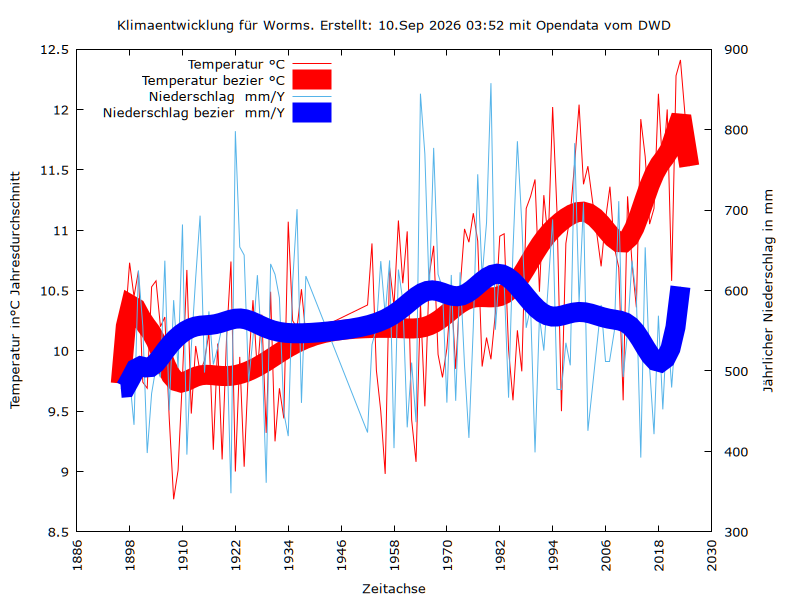

# Klimadiagramm 

Aus Daten vom DWD eine Klimagrafik für Deutsche Städte erstellen am Beispiel Worms.
Lokale Klimaentwicklung gemacht mit:
+Opendata vom DWD Observation
+Bash
+Wetterdiendt
+GNUplot

## Vorraussetzung:
Um die Daten abzurufen verwende ich [Wetterdienst](https://pypi.org/project/wetterdienst/) .

Ausführliche Beschreibung kommt noch
